# Diagrama entidad-relación de ClarIA

Generado desde la base de datos real con `scripts/esquema_a_diagramas.py`. GitHub dibuja este diagrama automáticamente. La versión editable está en [ClariaDB-v2.drawio](ClariaDB-v2.drawio).

```mermaid
erDiagram
    ACHIEVEMENTS ||--o{ ACHIEVEMENT_RULE_GROUPS : achievement_id
    ACHIEVEMENT_RULE_GROUPS ||--o{ ACHIEVEMENT_RULES : rule_group_id
    COURSES |o--o{ ACHIEVEMENTS : course_id
    SOURCES ||--o{ ARTICLE_SOURCES : source_id
    ARTICLES ||--o{ ARTICLE_SOURCES : article_id
    LESSONS ||--o{ ARTICLES : lesson_id
    AUDIT_LOGS ||--o{ AUDIT_LOG_CHANGES : audit_log_id
    AUDIT_ENTITY_TYPES ||--o{ AUDIT_LOGS : entity_type_id
    PROFILES |o--o{ AUDIT_LOGS : actor_id
    AGE_GROUPS ||--o{ COURSES : age_group_id
    CRITICAL_EXERCISES ||--o{ CRITICAL_EXERCISE_ISSUES : exercise_id
    LESSONS ||--o{ CRITICAL_EXERCISES : lesson_id
    ECO_FACTOR_VERSIONS ||--o{ ECO_ESTIMATES : factor_version_id
    PROFILES ||--o{ ECO_ESTIMATES : user_id
    ECO_FACTOR_VERSIONS ||--o{ ECO_FACTOR_SOURCES : factor_version_id
    SOURCES ||--o{ ECO_FACTOR_SOURCES : source_id
    ECO_TASK_TYPES ||--o{ ECO_FACTOR_VERSIONS : task_type_id
    CRITICAL_EXERCISES ||--o{ EXERCISE_ATTEMPTS : exercise_id
    PROFILES ||--o{ EXERCISE_ATTEMPTS : user_id
    FLASHCARDS ||--o{ FLASHCARD_REVIEWS : card_id
    PROFILES ||--o{ FLASHCARD_REVIEWS : user_id
    LESSONS ||--o{ FLASHCARDS : lesson_id
    LESSONS ||--o{ LESSON_ACTIVITIES : lesson_id
    PROFILES ||--o{ LESSON_PROGRESS : user_id
    LESSONS ||--o{ LESSON_PROGRESS : lesson_id
    COURSES ||--o{ LESSONS : course_id
    PROFILES ||--o{ PRIVACY_CONSENTS : user_id
    PRIVACY_NOTICE_VERSIONS ||--o{ PRIVACY_CONSENTS : notice_version_id
    AUTH_USERS ||--|| PROFILES : id
    ROLES ||--o{ PROFILES : role_id
    PROFILES ||--o{ PROMPT_ATTEMPTS : user_id
    SCENARIOS ||--o{ PROMPT_ATTEMPTS : scenario_id
    QUESTIONS ||--o{ QUESTION_OPTIONS : question_id
    QUIZZES ||--o{ QUESTIONS : quiz_id
    QUIZ_ANSWERS ||--o{ QUIZ_ANSWER_OPTIONS : answer_id
    QUESTION_OPTIONS ||--o{ QUIZ_ANSWER_OPTIONS : option_id
    QUESTIONS ||--o{ QUIZ_ANSWERS : question_id
    QUIZ_ATTEMPTS ||--o{ QUIZ_ANSWERS : attempt_id
    PROFILES ||--o{ QUIZ_ATTEMPTS : user_id
    QUIZZES ||--o{ QUIZ_ATTEMPTS : quiz_id
    LESSONS |o--o{ QUIZZES : lesson_id
    COURSES |o--o{ QUIZZES : course_id
    SCENARIOS ||--o{ SCENARIO_CRITERIA : scenario_id
    SCENARIOS ||--o{ SCENARIO_RESPONSE_TEMPLATES : scenario_id
    CRITICAL_EXERCISE_ISSUES ||--o{ SELECTED_EXERCISE_ISSUES : issue_id
    EXERCISE_ATTEMPTS ||--o{ SELECTED_EXERCISE_ISSUES : attempt_id
    SURVEY_ANSWERS ||--o{ SURVEY_ANSWER_OPTIONS : answer_id
    SURVEY_OPTIONS ||--o{ SURVEY_ANSWER_OPTIONS : option_id
    SURVEY_RESPONSES ||--o{ SURVEY_ANSWERS : response_id
    SURVEY_QUESTIONS ||--o{ SURVEY_ANSWERS : question_id
    SURVEY_QUESTIONS ||--o{ SURVEY_OPTIONS : question_id
    SURVEYS ||--o{ SURVEY_QUESTIONS : survey_id
    PROFILES ||--o{ SURVEY_RESPONSES : user_id
    SURVEYS ||--o{ SURVEY_RESPONSES : survey_id
    PROFILES ||--o{ USER_ACHIEVEMENTS : user_id
    ACHIEVEMENTS ||--o{ USER_ACHIEVEMENTS : achievement_id
    AUTH_USERS {
        uuid id PK
    }
    ACHIEVEMENT_RULE_GROUPS {
        uuid id PK
        uuid achievement_id FK
        text match_mode
    }
    ACHIEVEMENT_RULES {
        uuid id PK
        uuid rule_group_id FK
        text metric
        text operator
        numeric target_value
    }
    ACHIEVEMENTS {
        uuid id PK
        text name UK
        text description
        text icon "opcional"
        uuid course_id FK, UK "opcional"
        smallint sort_order
    }
    AGE_GROUPS {
        uuid id PK
        text code UK
        text name
        smallint min_age
        smallint max_age "opcional"
        smallint sort_order UK
    }
    ARTICLE_SOURCES {
        uuid article_id FK, PK
        uuid source_id FK, PK
    }
    ARTICLES {
        uuid id PK
        uuid lesson_id FK, UK
        text title UK
        text summary
        text body
        text author
        text published_label "opcional"
        boolean is_public
        date reviewed_at "opcional"
    }
    AUDIT_ENTITY_TYPES {
        uuid id PK
        text name UK
    }
    AUDIT_LOG_CHANGES {
        uuid id PK
        uuid audit_log_id FK
        text field_name
        text old_value "opcional"
        text new_value "opcional"
    }
    AUDIT_LOGS {
        uuid id PK
        uuid actor_id FK "opcional"
        uuid entity_type_id FK
        uuid entity_id
        text action
        timestamptz created_at
    }
    COURSES {
        uuid id PK
        uuid age_group_id FK, UK
        smallint level_number UK
        text title
        text objective
        smallint sort_order UK
        boolean is_published
        timestamptz deleted_at "opcional"
        timestamptz created_at
        timestamptz updated_at
    }
    CRITICAL_EXERCISE_ISSUES {
        uuid id PK
        uuid exercise_id FK
        text issue_type
        text fragment
        text explanation
    }
    CRITICAL_EXERCISES {
        uuid id PK
        uuid lesson_id FK
        text ai_text
        text explanation
    }
    ECO_ESTIMATES {
        uuid id PK
        uuid user_id FK
        uuid factor_version_id FK
        integer interactions
        timestamptz created_at
    }
    ECO_FACTOR_SOURCES {
        uuid factor_version_id FK, PK
        uuid source_id FK, PK
    }
    ECO_FACTOR_VERSIONS {
        uuid id PK
        uuid task_type_id FK, UK
        numeric water_ml_min
        numeric water_ml_max
        numeric energy_wh
        date valid_from UK
    }
    ECO_TASK_TYPES {
        uuid id PK
        text name UK
    }
    EXERCISE_ATTEMPTS {
        uuid id PK
        uuid user_id FK
        uuid exercise_id FK
        text justification "opcional"
        numeric score "opcional"
        timestamptz created_at
    }
    FLASHCARD_REVIEWS {
        uuid user_id FK, PK
        uuid card_id FK, PK
        smallint box
        timestamptz next_review_at
        timestamptz updated_at
    }
    FLASHCARDS {
        uuid id PK
        uuid lesson_id FK, UK
        text front
        text back
        smallint sort_order UK
    }
    LESSON_ACTIVITIES {
        uuid id PK
        uuid lesson_id FK, UK
        text title
        text provider
        text embed_url
        smallint sort_order UK
    }
    LESSON_PROGRESS {
        uuid user_id FK, PK
        uuid lesson_id FK, PK
        text status
        integer time_spent_s
        timestamptz last_activity_at
        timestamptz completed_at "opcional"
    }
    LESSONS {
        uuid id PK
        uuid course_id FK, UK
        text code UK
        text title
        text content
        text type
        smallint sort_order UK
        smallint duration_min "opcional"
        timestamptz deleted_at "opcional"
        timestamptz created_at
        timestamptz updated_at
    }
    PRIVACY_CONSENTS {
        uuid id PK
        uuid user_id FK, UK
        uuid notice_version_id FK, UK
        timestamptz accepted_at
    }
    PRIVACY_NOTICE_VERSIONS {
        uuid id PK
        text version UK
        text content_reference
        timestamptz published_at
    }
    PROFILES {
        uuid id FK, PK
        text full_name
        date birth_date
        text institution "opcional"
        text academic_level "opcional"
        uuid role_id FK
        boolean is_active
        timestamptz created_at
        timestamptz updated_at
    }
    PROMPT_ATTEMPTS {
        uuid id PK
        uuid user_id FK, UK
        uuid scenario_id FK, UK
        smallint score
        smallint attempt_no UK
        timestamptz created_at
    }
    QUESTION_OPTIONS {
        uuid id PK
        uuid question_id FK, UK
        text option_text
        boolean is_correct
        smallint correct_order "opcional"
        smallint sort_order UK
    }
    QUESTIONS {
        uuid id PK
        uuid quiz_id FK, UK
        text statement
        text type
        text explanation "opcional"
        smallint sort_order UK
    }
    QUIZ_ANSWER_OPTIONS {
        uuid answer_id FK, PK
        uuid option_id FK, PK
    }
    QUIZ_ANSWERS {
        uuid id PK
        uuid attempt_id FK, UK
        uuid question_id FK, UK
        text text_answer "opcional"
        numeric score_earned "opcional"
    }
    QUIZ_ATTEMPTS {
        uuid id PK
        uuid user_id FK
        uuid quiz_id FK
        numeric score
        boolean passed
        timestamptz started_at
        timestamptz finished_at
    }
    QUIZZES {
        uuid id PK
        uuid lesson_id FK "opcional"
        uuid course_id FK "opcional"
        text title
        numeric passing_score
        boolean is_published
    }
    ROLES {
        uuid id PK
        text name UK
    }
    SCENARIO_CRITERIA {
        uuid id PK
        uuid scenario_id FK, UK
        text criterion_key UK
        text label
        smallint weight
        smallint sort_order UK
    }
    SCENARIO_RESPONSE_TEMPLATES {
        uuid id PK
        uuid scenario_id FK
        smallint min_score
        smallint max_score
        text response_text
    }
    SCENARIOS {
        uuid id PK
        text title
        text goal
        boolean is_published
    }
    SELECTED_EXERCISE_ISSUES {
        uuid attempt_id FK, PK
        uuid issue_id FK, PK
    }
    SOURCES {
        uuid id PK
        text citation
        text url UK
        date consulted_at "opcional"
    }
    SURVEY_ANSWER_OPTIONS {
        uuid answer_id FK, PK
        uuid option_id FK, PK
    }
    SURVEY_ANSWERS {
        uuid id PK
        uuid response_id FK, UK
        uuid question_id FK, UK
        text text_answer "opcional"
        numeric numeric_value "opcional"
    }
    SURVEY_OPTIONS {
        uuid id PK
        uuid question_id FK, UK
        text option_text
        numeric numeric_value "opcional"
        smallint sort_order UK
    }
    SURVEY_QUESTIONS {
        uuid id PK
        uuid survey_id FK, UK
        text prompt
        text response_type
        boolean is_required
        smallint sort_order UK
    }
    SURVEY_RESPONSES {
        uuid id PK
        uuid user_id FK
        uuid survey_id FK
        timestamptz submitted_at
    }
    SURVEYS {
        uuid id PK
        text type
        text title
        boolean is_published
    }
    USER_ACHIEVEMENTS {
        uuid user_id FK, PK
        uuid achievement_id FK, PK
        timestamptz earned_at
    }
```

